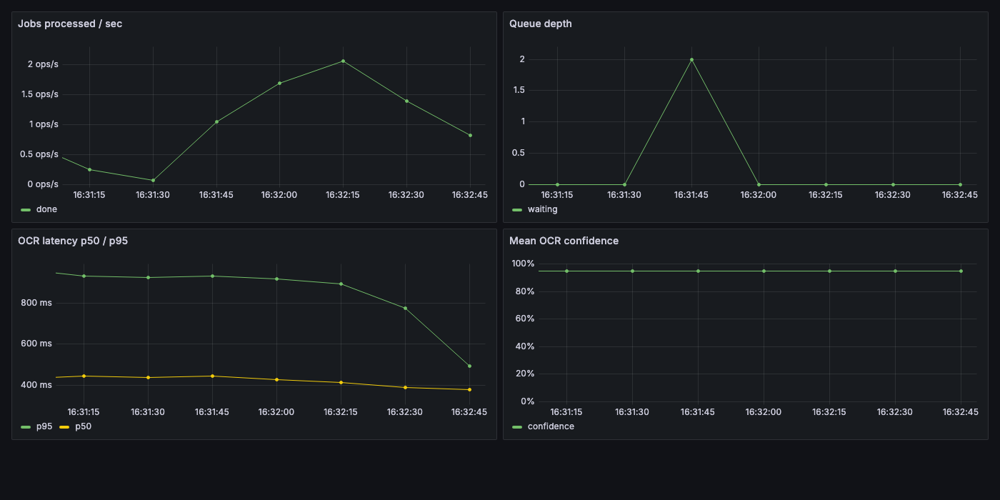
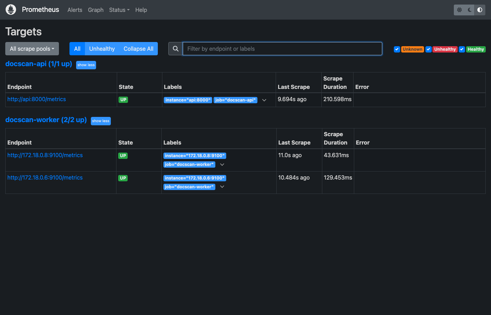
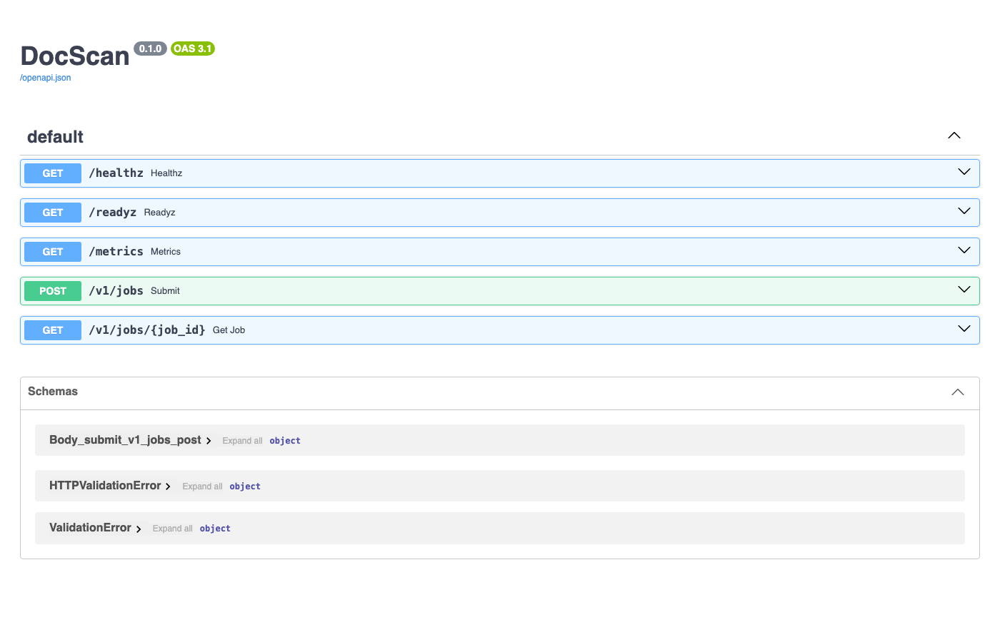

# DocScan Platform

A production-style **OCR service** built to show end-to-end DevOps: containerised app, Kubernetes, CI/CD, GitOps, observability, and infrastructure as code.

> Inspired by the idea behind neural-maze's *production-ocr-course*. This is an independent implementation: different code and architecture, with the platform engineering (K8s, GitOps, IaC, observability) as the focus.

## How it works
```
Client -> Ingress (nginx) -> API (FastAPI) -> Redis queue -> OCR workers (OpenCV + Tesseract)
                                  |                                   |
                                  +-------------- MySQL --------------+
        Prometheus  <-- /metrics (api, workers) --> Grafana + alert rules
```
`POST /v1/jobs` stores the upload, records a job in MySQL, enqueues it, and returns `202`. Workers pick jobs up, preprocess the image (denoise, adaptive threshold), run Tesseract, and store text plus a mean word-confidence score. Results below a threshold are flagged `low_confidence` instead of silently trusted. Poll `GET /v1/jobs/{id}`.

## Screenshots
**Grafana**: throughput, queue depth, OCR latency (p50/p95), and confidence under a burst of 110 jobs on two workers.


**Prometheus**: API and both workers scraped successfully.


**API docs** (FastAPI/OpenAPI):


## DevOps map
| Area | Where |
|---|---|
| Docker | `Dockerfile` (multi-stage, non-root), `docker-compose.yml` |
| MySQL | `app/docscan/db.py` (indexed schema), `k8s/dependencies.yaml` (backup CronJob), `terraform/main.tf` (RDS) |
| Kubernetes | `helm/docscan/` (probes, limits, securityContext, HPA, NetworkPolicies) |
| Networking | `docs/network-path.md`, default-deny policies |
| CI/CD | `.github/workflows/ci.yml`: lint, test, helm lint, terraform validate, Trivy scan, push to GHCR |
| GitOps | CI commits the new image tag; `argocd/application.yaml` syncs it with self-heal |
| Observability | `monitoring/` (Prometheus alerts), app metrics in `metrics.py` |
| IaC | `terraform/` (VPC, EKS, RDS with managed secret, ECR) |
| Ops | `docs/runbook.md` |

## Run locally
```bash
make up                                   # api :8000, prometheus :9090, grafana :3000
curl -F file=@scan.png http://localhost:8000/v1/jobs
curl http://localhost:8000/v1/jobs/<id>
# port 8000 busy? API_PORT=8080 docker compose up -d --build
```

## Run on Kubernetes (kind)
```bash
kind create cluster --name docscan
kubectl create ns docscan
helm install docscan helm/docscan -n docscan --set image.repository=<your image> --set image.tag=<tag>
kubectl apply -f k8s/dependencies.yaml
```
Then install Argo CD and `kubectl apply -f argocd/application.yaml` to let git drive the cluster.

## Tests
```bash
pip install -r requirements-dev.txt && pytest -q
```
Tests use an in-memory queue, SQLite, and a fake OCR engine, so they need no services.

## Performance notes (found while load-testing)
First run: ~6 s per small invoice and a growing queue. Two fixes took it to **~0.4 s p50 / <1 s p95 and ~2 jobs/s on two workers**:
1. **Thread oversubscription.** Tesseract (OpenMP) and OpenCV each spawned threads per worker, so workers fought over CPUs. Fix: `OMP_THREAD_LIMIT=1` and `cv2.setNumThreads(1)`. One worker is one core, and parallelism comes from replicas.
2. **Double OCR pass.** Text and confidence came from two Tesseract calls. Fix: derive both from one `image_to_data` call.

## Design decisions
- **Async queue** keeps API latency flat; OCR time never blocks requests.
- **Readiness checks dependencies** (MySQL + Redis); liveness doesn't, so an outage drains traffic instead of restart-looping pods.
- **Workers handle SIGTERM** by finishing the current job (`terminationGracePeriodSeconds: 60`).
- **CI never touches the cluster**: it only commits an image tag. Argo CD is the sole deployer.
- **Known limits / next steps**: scale workers on queue depth with KEDA instead of CPU; use EFS or S3 instead of a shared volume; add PDF support, a dead-letter queue, and retries.
